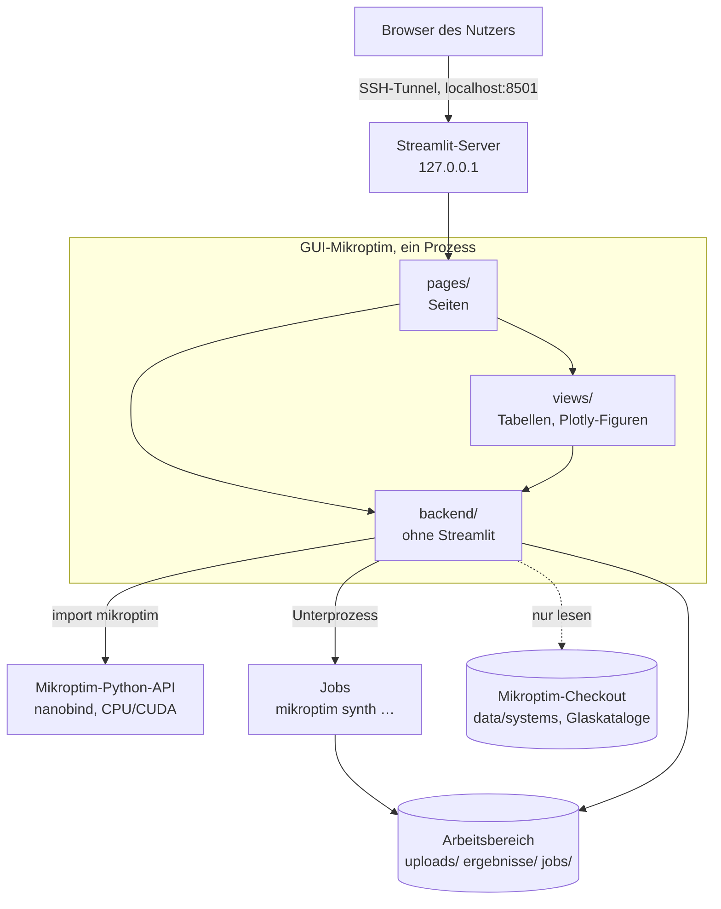

# Architektur

## Überblick

Die GUI ist eine dünne Schicht über Mikroptim (ADR-0002). Sie lädt Dateien, ruft Mikroptim auf, stellt Ergebnisse dar und verwaltet lange Läufe als Jobs (ADR-0003). Es gibt keine eigene Optik, keine Datenbank und keine Benutzerverwaltung (ADR-0004).

## Schichten

| Schicht | Verzeichnis | Darf importieren | Aufgabe |
|---|---|---|---|
| Seiten | `src/gui_mikroptim/pages/` | `views`, `backend`, `streamlit` | Layout, Widgets, Ablauf einer Seite. Keine Logik, die man testen müsste, ohne die Seite zu rendern. |
| Views | `src/gui_mikroptim/views/` | `backend`, `streamlit`, `plotly`, `numpy` | Wiederverwendbare Darstellungen: Systemtabelle, OPD-Karte, Spotdiagramm, Verlaufskurve. Plotly-Figuren werden von reinen Funktionen erzeugt (testbar ohne Streamlit). |
| Backend | `src/gui_mikroptim/backend/` | `numpy`, Standardbibliothek, `mikroptim` (nur `mko.py`, `jobs.py`) | Dateien, Anbindung an Mikroptim, Protokolle, Jobs. **Kein** `streamlit`. |
| Konfiguration | `src/gui_mikroptim/config.py` | Standardbibliothek | Einstellungen aus Umgebungsvariablen |

### Views

| Modul | Stand | Inhalt |
|---|---|---|
| `views/common.py` | G0 | Einstellungen, Mikroptim-Status, Seitenleiste, Platzhalter |
| `views/file_picker.py` | G4-T2 | Quelle und Datei nach Format wählen (Upload und seitenübergreifende Auswahl folgen mit G1-T1) |
| `views/synth_plots.py` | G4-T2 | Verlaufsfigur eines Synthese-Protokolls (rein, ohne Streamlit) |
| `views/synth_view.py` | G4-T2 | Darstellung eines Synthese-Protokolls |

### Backend-Module

| Modul | Stand | Inhalt |
|---|---|---|
| `backend/files.py` | G0 | Pfade unter einer Wurzel auflösen (Schutz vor `..` und Symlinks), Dateilisten, sichere Dateinamen, neue Dateien ohne Überschreiben |
| `backend/mko.py` | G0 | Status von Mikroptim (Version, CUDA, Geräte), `require()`; einziger `import mikroptim` |
| `backend/protocols.py` | G0 | JSON-Formate von Mikroptim erkennen, `mikroptim.synth/1` in Tabellenzeilen und Stammbaum (DOT) umordnen |
| `backend/protocols.py` (Erweiterung) | G4-T2 | Format aus dem Dateianfang (`peek_format`), Dateilisten nach Format (`list_documents`), Kandidaten- und Zieltabellen, Schrittfilter |
| `backend/jobs.py` | G4-T1 | Jobs als Unterprozesse, Ablage `gui-mikroptim.job/1` |
| `backend/compute.py` | G2-T1 | dünne Hüllen um `trace`, `evaluate`, `psf`, mit Rückgabe als einfache Datenklassen für die Views |

## Seiten

| Seite | Datei | Meilenstein | Rechnet im Streamlit-Prozess? |
|---|---|---|---|
| Start | `pages/start.py` | G0 | nein (nur Status) |
| System | `pages/system.py` | G1 | Laden und Paraxialdaten (Millisekunden) |
| Auswertung | `pages/auswertung.py` | G2 | `trace`, `evaluate`, PSF für ein System (Sekunden) |
| Optimierung | `pages/optimierung.py` | G3 | `optimize` mit Rückruf (Sekunden bis Minuten, mit Abbruch) |
| Jobs und Synthese | `pages/synthese.py` | G4 | nein: startet Jobs und liest deren Dateien |

## Zustand und Cache

Streamlit führt das Seitenskript bei jeder Interaktion neu aus. Daraus folgen feste Regeln:

- **Einstellungen und Mikroptim-Status** sind `st.cache_resource` (einmal pro Serverprozess, Knopf „Neu prüfen“ leert den Status).
- **Geladene Systeme und Rechenergebnisse** sind `st.cache_data`. Der Schlüssel enthält den aufgelösten Pfad, die Änderungszeit und die Größe der Datei sowie alle Rechenoptionen (Ringe, Speichen, Raster, GPU, Genauigkeit). Eine geänderte Datei wird so nie mit altem Ergebnis gezeigt.
- Objekte aus Mikroptim (`System`, `Wavefront`, …) sind nanobind-Objekte. Gecacht werden die daraus gewonnenen NumPy-Arrays und Zahlen, nicht die Objekte selbst; nur `System` darf als Ressource gecacht werden, weil es unveränderlich ist.
- **Auswahl des Nutzers** (gewählte Datei, Feld, Wellenlänge) liegt in `st.session_state` unter Schlüsseln mit Seitenpräfix, z. B. `system.datei`, `auswertung.feld`. Die gewählte Datei ist seitenübergreifend `aktuell.datei`.
- Der Streamlit-Prozess wird von allen Browsersitzungen geteilt. GPU-Rechnungen im Prozess sind kurz zu halten; was länger dauert, wird ein Job.

## Jobs (ab G4-T1)

Lange Läufe laufen als eigener Prozess (ADR-0003):

1. Die Seite erzeugt eine Jobbeschreibung (Befehl als Argumentliste, Eingabedateien, Optionen, Seed).
2. `backend/jobs.py` legt `jobs/<JJJJMMTT-hhmmss>-<kurz>/` an, kopiert die Eingaben dorthin, schreibt `job.json` und startet den Prozess mit Arbeitsverzeichnis im Jobordner. `stdout`/`stderr` gehen nach `ausgabe.txt`/`fehler.txt`.
3. Der Status ergibt sich aus der Prozess-ID, dem Exit-Code (`exit_code` in `job.json`, geschrieben von einem kleinen Wrapper) und den Dateien. Die GUI kann neu starten, ohne laufende Jobs zu verlieren.
4. Die Seite liest Ausgaben und Protokolle zyklisch (`st.fragment(run_every=…)`), nicht durch Blockieren.

Format `gui-mikroptim.job/1` (`job.json`):

| Feld | Bedeutung |
|---|---|
| `format` | `"gui-mikroptim.job/1"` |
| `id` | Name des Jobordners |
| `kind` | `synth`, `optimize`, `eval`, … |
| `argv` | vollständige Argumentliste, so wie gestartet (reproduzierbar per Hand) |
| `inputs` | kopierte Eingabedateien (relativ zum Jobordner) |
| `mikroptim_version` | Version beim Start |
| `created`, `started`, `finished` | Zeitpunkte (ISO 8601, UTC) |
| `pid`, `exit_code` | Prozess-ID, Exit-Code (`null` solange laufend) |
| `status` | `wartend`, `läuft`, `fertig`, `fehler`, `abgebrochen` |

Gleichzeitig laufende Jobs sind auf `MKO_GUI_MAX_JOBS` begrenzt (Standard 1, weil die GPU geteilt wird).

## Fehlerbehandlung

- Ausnahmen von Mikroptim (`FormatError` mit `json_path`, `GlassError`, `GpuUnavailableError`, `CudaError`) werden auf der Seite mit `st.error` gezeigt, mit JSON-Pfad, wenn vorhanden. Die App stürzt nicht ab.
- Ohne Mikroptim laufen alle Seiten und zeigen einen Hinweis; das prüfen die App-Tests (`tests/test_app.py`).
