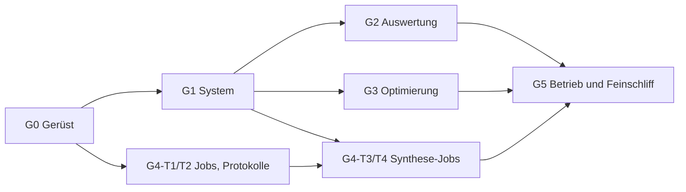

# Meilensteinplan für Agenten

Jede Aufgabe hat eine ID (`G<n>-T<k>`; `G` unterscheidet sie von den Aufgaben `M…` in Mikroptim), Abhängigkeiten und Abnahmekriterien. Eine Aufgabe ist ein PR (siehe AGENTS.md). Aufgaben innerhalb eines Meilensteins ohne gegenseitige Abhängigkeit können parallel bearbeitet werden.

Allgemeine Abnahme für jede Seite (gilt zusätzlich zu den Kriterien der Aufgabe): `AppTest` der Seite ohne Ausnahme mit und ohne Mikroptim; Integrationstest mit Mikroptim auf mindestens einem Beispielsystem; Screenshot im PR; Eintrag in docs/bedienung.md und, bei neuen Aufrufen, in docs/schnittstelle-mikroptim.md.

## Übersicht

G4-T1 und G4-T2 hängen nur von G0 ab: Der Protokollbrowser für vorhandene Synthese-Läufe (z. B. die Ergebnisse von Mikroptim M6-T6) ist sofort nützlich und kann parallel zu G1 entstehen.

---

## G0 – Gerüst ✅

Erledigt mit dem ersten Commit: Paket und Startprogramm, Konfiguration, `backend/files.py`, `backend/mko.py`, `backend/protocols.py`, Startseite, Platzhalterseiten, Tests (Einheiten, AppTest, Integration), CI, Dokumentation, ADR-0001 bis ADR-0005, dieser Plan.

---

## G1 – System ✅

### G1-T1 – Dateiauswahl und Upload ✅
- **Abhängig von:** G0
- **Inhalt:** Baustein `views/file_picker.py`: Quelle wählen (Beispielsysteme aus `MKO_GUI_MIKROPTIM_REPO/data/systems`, `uploads/`, `ergebnisse/`, später Jobordner), Datei aus `files.list_files` wählen, Upload nach `uploads/` über `files.write_new_file`. Format vorab mit `protocols.load_document` prüfen. Auswahl in `st.session_state["aktuell.datei"]` (seitenübergreifend).
- **Abnahme:**
  - Ein hochgeladenes System erscheint sofort in der Liste; gleicher Name zweimal ergibt `name-2.json`, nichts wird überschrieben.
  - Upload mit falschem Format (`mikroptim.glass/1`, kein JSON, fremdes Format) wird mit Meldung abgelehnt und nicht gespeichert.
  - Wechsel der Seite behält die gewählte Datei.

### G1-T2 – Systemtabelle und Paraxialdaten ✅
- **Abhängig von:** G1-T1
- **Inhalt:** `backend/compute.py` mit `load_system_cached` (Schlüssel: Pfad, mtime, Größe). Tabellen: Flächen (Typ, Krümmung, Radius zur Anzeige, Dicke, Material mit n bei λ_ref aus `System.indices`, Halbdurchmesser, Dezentrierung/Verkippung, Kommentar), Spektrum mit Gewichten, Felder mit Gewichten, Ziele, Variablen, Nebenbedingungen, Geisterplatten (aus `system_to_dict`). Paraxialdaten aus `Paraxial.to_dict()`. Warnungen aus `System.warnings`.
- **Abnahme:**
  - Für `einzellinse_bk7.json` zeigt die Seite f ≈ 101,05 mm und Schnittweite ≈ 99,05 mm, Werte identisch zu `mikroptim trace --json` (Test vergleicht mit `run_cli`).
  - Ein System mit Formatfehler zeigt die Meldung mit JSON-Pfad (`FormatError.json_path`), ohne Ausnahme der App.
  - Glaskataloge hochgeladener Dateien: Mikroptim sucht `glass_catalogs` vom Verzeichnis der Datei aus aufwärts, Dateien in `uploads/` finden Kataloge wie `data/glass/basis.json` also nicht. Lösung ohne eigene Pfadlogik: Kann `load_system` die Kataloge nicht finden, bietet die Seite an, die Datei mit `System.from_json(text, base_dir=<Mikroptim-Checkout>)` zu laden und mit `System.save()` als neue Datei unter `uploads/` zu speichern (Mikroptim schreibt die Katalogpfade relativ zur neuen Datei). Test mit einer hochgeladenen Kopie von `einzellinse_bk7.json`.
  - Alle Beispielsysteme in `data/systems` laden ohne Ausnahme der App (parametrisierter Integrationstest).

### G1-T3 – Linsenschnitt ✅
- **Abhängig von:** G1-T2
- **Inhalt:** Plotly-Figur in `views/lens_plot.py` aus Krümmung, Dicke und Halbdurchmesser (y-z-Schnitt, Pfeilhöhe exakt für die Zeichnung, Linsenkörper gefüllt, Blende markiert, Geisterplatten gestrichelt, Bildebene). Dezentrierung und Verkippung nach den Konventionen von Mikroptim (ADR-0011 dort) nur darstellen. Strahlen erst, wenn Mikroptim-Wunsch W1 erfüllt ist (eigene Folgeaufgabe).
- **Abnahme:**
  - Funktion ist ohne Streamlit getestet: Planplatte ergibt Rechtecke, Bikonvexlinse die erwarteten Scheitel- und Randpunkte (Pfeilhöhe gegen geschlossene Formel).
  - Seitenverhältnis 1, Achsen in mm, Screenshot von `testsystem_mehrlinser.json` und `testsystem_mehrlinser_dezentriert.json` im PR.

---

## G2 – Auswertung ✅

### G2-T1 – RMS-Wellenfront ✅
- **Abhängig von:** G1-T2
- **Inhalt:** `mikroptim.trace` mit Ringen, Speichen, GPU, Genauigkeit (`fp64`/`df64`, nur mit CUDA); Ergebnis als Tabelle und Heatmap Feld × Wellenlänge (Wellen bei λ_ref), versagte Strahlen markiert. Optionen in der Ergebnisüberschrift.
- **Abnahme:** Zahlen identisch zu `mikroptim trace --json` für zwei Beispielsysteme (Test); GPU-Schalter nur sichtbar mit CUDA-Build und Gerät; `GpuUnavailableError` wird als Meldung gezeigt.

### G2-T2 – EVAL: OPD-Karten und Spots ✅
- **Abhängig von:** G2-T1
- **Inhalt:** `mikroptim.evaluate` (Raster, halbe/volle Pupille, Referenz Austrittspupille/Scheitel); Auswahl Feld/Wellenlänge; OPD-Karte mit Abzug (keiner, Kippung, Kippung und Defokus), Spotdiagramm, Kennzahlentabelle aus `stats`.
- **Abnahme:** Figuren-Funktionen getestet (NaN außerhalb der Pupille bleibt leer, Farbskala symmetrisch); Kennzahlen identisch zu `mikroptim eval --json`.

### G2-T3 – PSF, MTF, Strehl ✅
- **Abhängig von:** G2-T2
- **Inhalt:** `Evaluation.psf` (skalar): PSF linear und logarithmisch, MTF sagittal/tangential mit Beugungsgrenze als Bezug aus den Rückgabewerten, Strehl. Vektorielle PSF über `mikroptim eval --vector --json` (bis Wunsch W3), als kurzer Aufruf oder Job je nach Rasterzahl.
- **Abnahme:** Strehl und MTF identisch zu `mikroptim eval --psf --json`; Hinweis bei NA > 0,6, dass die skalare Näherung ungenau ist (Mikroptim M8-T2).

### G2-T4 – Vergleich zweier Systeme ✅
- **Abhängig von:** G2-T1
- **Inhalt:** zweites System wählen; RMS-Tabellen nebeneinander und als Differenz, Paraxialdaten nebeneinander. Typischer Fall: Ergebnis einer Synthesestufe gegen die vorige.
- **Abnahme:** Vergleich nur bei gleichen Feldern und Wellenlängen als Differenz, sonst nebeneinander mit Hinweis (Test).

---

## G3 – Optimierung

### G3-T1 – Variablen und Optionen ✅
- **Abhängig von:** G1-T2
- **Inhalt:** Variablen mit Schranken und Startwerten anzeigen (`System.variables()`); Optionen von `optimize` (Iterationen, Ringe/Speichen, Läufe, Störung, Seed, Jacobi `fd`/`adjoint`, GPU) als Formular mit Standardwerten aus der Mikroptim-Doku.
- **Abnahme:** Formular erzeugt genau die Argumente, die ein Test erwartet; ungültige Kombinationen (GPU ohne CUDA) sind nicht wählbar.

### G3-T2 – Lauf mit Live-Verlauf ✅
- **Abhängig von:** G3-T1
- **Inhalt:** `optimize(..., callback=...)`; Merit-Verlauf (log) und aktueller Zyklus live; Knopf „Abbrechen“ über Ausnahme im Rückruf; Laufzeitgrenze, danach Hinweis auf Job (G4).
- **Abnahme:** Ergebnis identisch zu `mikroptim optimize` mit denselben Optionen (Merit bitgleich, Test auf `einzellinse_bk7_biegung.json`); Abbruch hinterlässt einen nutzbaren Zustand und eine Meldung.

### G3-T3 – Ergebnis und Speichern
- **Abhängig von:** G3-T2
- **Inhalt:** Vorher/Nachher (Variablen, Merit, RMS-Wellenfront); Speichern über `OptimizeResult.system.save` unter `ergebnisse/` (neuer Name, nie Überschreiben); Ergebnis direkt als aktuelle Datei übernehmen.
- **Abnahme:** gespeicherte Datei lädt mit `mikroptim trace` und reproduziert die Endmerit (Test); Eingabedatei unverändert (Hash vorher/nachher).

---

## G4 – Jobs und Synthese

### G4-T1 – Jobverwaltung ✅
- **Abhängig von:** G0
- **Inhalt:** `backend/jobs.py` nach docs/architektur.md, „Jobs“ (Format `gui-mikroptim.job/1`, Jobordner, eigene Prozessgruppe, Exit-Code über Wrapper, Begrenzung `MKO_GUI_MAX_JOBS`, Abbrechen per Signal an die Prozessgruppe); Seite mit Jobliste, Status, Ausgabe (Ende von `ausgabe.txt`, zyklisch über `st.fragment(run_every=…)`), Befehl zum Kopieren.
- **Abnahme:**
  - Tests mit einem harmlosen Python-Ersatzbefehl: Start, Status `läuft` → `fertig`, Exit-Code ≠ 0 → `fehler`, Abbruch → `abgebrochen`, Grenze der gleichzeitigen Jobs.
  - Ein laufender Job überlebt einen Neustart der GUI und wird danach korrekt angezeigt.
  - Linux und Windows (CI), Abbruch unter Windows über `CTRL_BREAK_EVENT` oder `taskkill /T`.

### G4-T2 – Protokollbrowser `mikroptim.synth/1` ✅
- **Abhängig von:** G0
- **Inhalt:** Protokoll wählen (Arbeitsbereich, Jobordner, Mikroptim-Checkout z. B. `docs/ergebnisse/`); Kopfzeile aus `SynthProtocol.summary()`; Schritttabelle mit Filter (Art, angenommen, Aktion); Verlauf über die Schritte (NA, Feld, Spektrum, RMS, Elemente; Einfügungen als Marker); Stammbaum über `candidate_tree_dot`, oder die mitgelieferte DOT-Datei; Ziel-Tupel (`result.goal.tuples`) als Tabelle.
- **Abnahme:** Testprotokoll `tests/daten/synth_beispiel.json` und ein echtes Protokoll aus Mikroptim (Integrationstest, falls vorhanden) werden ohne Ausnahme dargestellt; Screenshot mit einem Lauf aus M6-T6.

### G4-T3 – Synthese-Job ✅
- **Abhängig von:** G4-T1, G1-T1
- **Inhalt:** Formular für `mikroptim synth` (Startsystem, Ziel-NA, Strahlbreite, Seed, Alternativen, Starts, Vorfilter, GPU, Jacobi); Start als Job mit `--log` und `--dot`; Fortschritt aus der Textausgabe; nach Ende direkt in den Protokollbrowser.
- **Abnahme:** Kurzer Synthese-Lauf (z. B. `einzellinse_homotopie_start.json` mit kleiner Ziel-NA) als Integrationstest; Protokoll gleich einem Lauf von Hand mit dem gespeicherten Befehl (ohne `seconds`).

### G4-T4 – Ergebnisordner
- **Abhängig von:** G4-T2
- **Inhalt:** einen Ordner mit Stufenergebnissen (wie `docs/ergebnisse/m6-t6/` in Mikroptim) als Lauf darstellen: Stufen, Systemdateien, Bewertungen; Sprung in System, Auswertung und Vergleich.
- **Abnahme:** Ordner von M6-T6 (nach Merge in Mikroptim) vollständig navigierbar; Screenshot.

---

## G5 – Betrieb und Feinschliff

### G5-T1 – Dienst und Jobs auf dem Server
- **Abhängig von:** G4-T1
- **Abnahme:** Installation nach docs/betrieb.md auf dem Server nachvollzogen (Protokoll im PR), Neustart des Dienstes bricht keinen Job ab.

### G5-T2 – Leistung
- **Abhängig von:** G2, G3
- **Inhalt:** Caching überprüfen, große Raster ausdünnen (`Scattergl`), Ladezeiten messen.
- **Abnahme:** Seitenwechsel ohne neue Rechnung < 1 s bei gecachten Ergebnissen; Messwerte im PR.

### G5-T3 – Export
- **Abhängig von:** G2
- **Inhalt:** Tabellen als CSV, Diagramme als PNG/SVG (Plotly), kurzer Bericht eines Systems als Markdown.
- **Abnahme:** Exporte im Test erzeugt und gelesen.

---

## Querschnittsaufgaben

- CI aktuell halten, Integration gegen Mikroptim `main` grün halten; bei API-Änderungen in Mikroptim Wunschliste und Schnittstellendoku pflegen.
- docs/ und CHANGELOG.md mit jeder Aufgabe pflegen.
- Neue ADR bei jeder grundsätzlichen Entscheidung.
